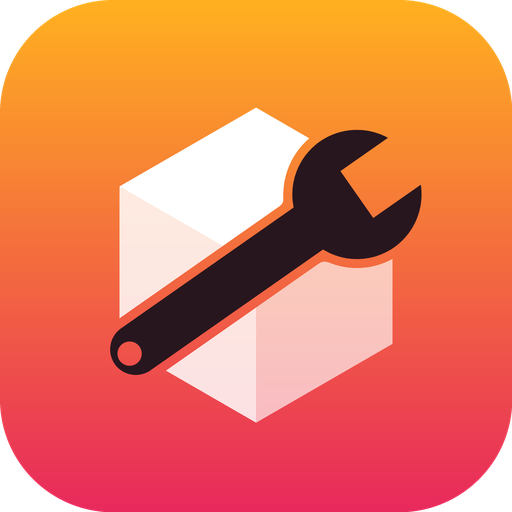
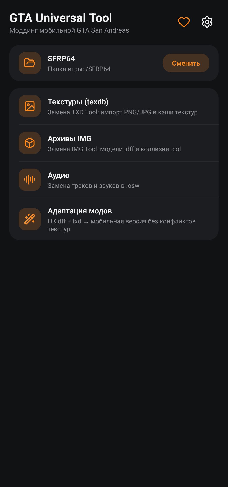
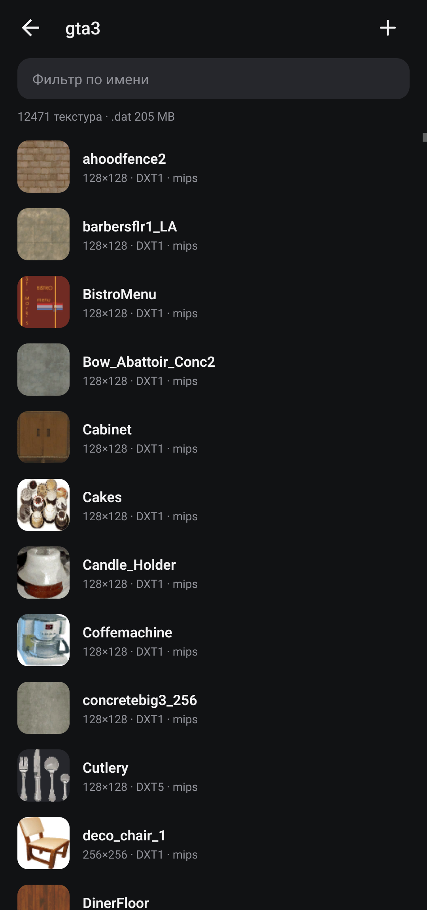

# GTA Universal Tool

**All-in-one modding tool for mobile GTA San Andreas on Android**

Texture caches (texdb) · IMG archives · audio · PC mod adaptation, including whole-map retextures — right on the phone.

[Русский](README.md) · **English** · [Español](README.es.md) · [Bahasa Indonesia](README.id.md)

A free, open-source replacement for **TXD Tool** and **IMG Tool** for the Android version of GTA San Andreas and SA-MP mobile clients. No ads, no trackers, works offline.

Made with the support of **[San Fierro RolePlay](https://sf-rp.com)**.

> Playing on SA:MP servers? **[SA:MP Monitoring Bot](https://t.me/samp_monitoring_bot)** sends Telegram notifications about events on servers.

## Install

1. Download the APK from [Releases](https://github.com/timmylich/gta-universal-tool/releases/latest) and install it.
2. Open the app and allow "All files access" (Android 11+).
3. Choose the game folder, then follow the guide below. The same guide is in the app: home screen → "How to use".

## How to use

### Getting started

1. Allow "All files access": without it the app cannot see the game files.

2. Choose the game folder: the one with texdb/, audio/, data/. Usually /SFRP64, /Brentwood and similar, or Android/data/<game package>/files. The app looks for such folders itself.

3. Backups are on by default: before the first change every file is copied to /GTAUniversalTool/backup.

4. Close the game before making changes and start it again afterwards.

### Textures (texdb)

Texture caches hold what PC keeps in .txd files. gta3 — the map and objects, gta_int — interiors, txd — vehicles and more, samp — SA:MP objects, mobile and menu — the interface.
- One texture: open a database, find the texture with search, tap it → "Replace with image".
- Many at once: "+" in the database header, pick PNG/JPG files. The file name without extension is the texture name (case does not matter). New names are added, existing ones replaced.
- Long press selects several textures to export or delete.
- "alias" is a link to another texture with no data of its own. Replacing an alias turns it into a separate texture; the original stays as is.
- After many replacements tap "Rebuild .dat" to free the space of old data.

### Import options

"Auto" format fits almost always: DXT1 without transparency, DXT5 with it. Keep mipmaps and RLE on.

"Max size → As replaced" never makes a texture bigger than the original: the game does not get heavier and does not crash for lack of memory.

alphamode: 0 — opaque, 1 — cutout (foliage, fences), 2 — translucent (glass).

### IMG archives

IMG files are archives of models (.dff), collisions (.col) and animations. texdb/gta3.img holds the map and vehicle models.
- "+" adds or replaces files: Car.DFF replaces car.dff.
- Tap a file to export it, replace it with any file or delete it.
- Add new models only if the game will load them (an .ide must describe them): extra files may crash the game.
- "Rebuild" removes the gaps left by replacements and shrinks the archive.

### Audio

.osw packs in the audio folder are sets of mp3 files. The game plays tracks by number, so the order is kept. ▶ plays, "Replace mp3" picks your file, "+" appends tracks. "Apply" writes all changes in one rebuild.

### Models from PC

Adaptation → "Models + textures". Add .dff files (.txd files with the same names are picked up automatically) and other .txd files if needed. Every texture gets a unique "prefix_random" name, the .dff files are rewritten, and the textures can go straight into gta3 and the models into an IMG archive. To replace a model in the game, the .dff name must match the replaced one (e.g. infernus.dff). A copy of the result is saved to /GTAUniversalTool/adapted.

### Retexture, including the whole map

Adaptation → "Retexture". Only textures change; models stay the same.
- Unpack the .txd files of a PC mod (e.g. from the gta3.img of a winter mod) into a folder on the phone and tap "Add folder": every .txd is taken, subfolders included.
- On PC different .txd files may have textures with the same name but different pictures. The mobile cache stores those as "name_txd" (des_dirt1_cs_mountain), and identical ones as links (alias) to one copy. The app puts every texture where the game looks for it for that TXD: identical pictures are written once, different ones as separate copies.
- "Skip unchanged" leaves textures that are the same in the mod as in the game: faster, and the cache does not grow.
- "Max size → As replaced" keeps the map from getting heavier.
- Keep 1–2 GB free. After a retexture tap "Rebuild .dat" in the gta3 database.

### If something goes wrong

The game crashes or textures are black — restore the files from /GTAUniversalTool/backup: inside, the path from the storage root is repeated (e.g. backup/SFRP64/texdb/gta3/…). Common causes: textures that are too big, extra models in an IMG, damaged .dff files. Send bugs and ideas via "Support the project → Report a bug".

## Supported files

| What | Where | Notes |
|---|---|---|
| Texture caches | `texdb/<db>/<db>.{txt,dxt.toc,dxt.dat,dxt.tmb}` | DXT1, DXT5, RGBA8888, RGB565, RGBA4444, RLE, aliases |
| Archives | `*.img` (VER2) | dff, col, ipl, ifp, … |
| Audio | `audio/*/*.osw` + `.osw.idx` | stored ZIP of mp3 |
| PC mods | `.dff` + `.txd` (D3D8/D3D9) | DXT1/3/5, 8888, 888, 565, 1555, 4444, PAL8 |

The formats are documented in [docs/FORMATS.md](docs/FORMATS.md).

## Support the project

The app is developed in spare time. If it helped you: ⭐ star the repo, follow the [Telegram channel](https://t.me/timmylich_portfolio), report bugs, or donate (in the app: ♥ → "Support the project").

## Development

Native Android app: Kotlin + Jetpack Compose. Building and tests: [CONTRIBUTING.md](CONTRIBUTING.md).

## License

[GNU AGPL v3.0 or later](LICENSE). GTA and Grand Theft Auto are trademarks of Take-Two Interactive; this project is not affiliated with them. Do not publish game files.
