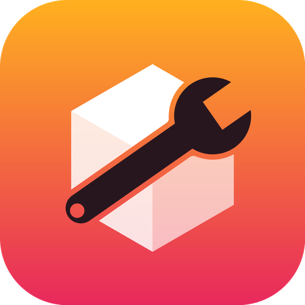
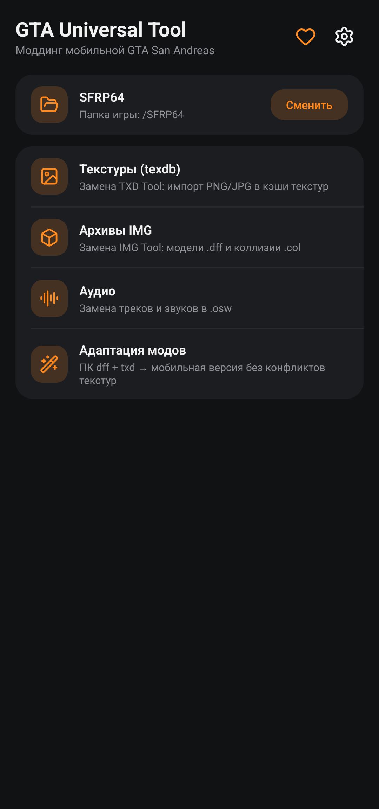
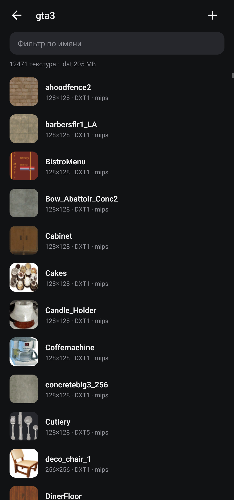

# GTA Universal Tool

**Todo para modificar GTA San Andreas para móvil en Android**

Cachés de texturas (texdb) · archivos IMG · audio · adaptación de mods de PC, incluido el retexturizado de todo el mapa, desde el teléfono.

[Русский](README.md) · [English](README.en.md) · **Español** · [Bahasa Indonesia](README.id.md)

Sustituto libre y de código abierto de **TXD Tool** e **IMG Tool** para GTA San Andreas en Android y los clientes móviles de SA-MP. Sin anuncios ni rastreadores, funciona sin conexión.

Creado con el apoyo de **[San Fierro RolePlay](https://sf-rp.com)**.

> ¿Juegas en servidores SA:MP? **[SA:MP Monitoring Bot](https://t.me/samp_monitoring_bot)** envía avisos a Telegram sobre eventos en los servidores.

## Instalación

1. Descarga el APK desde [Releases](https://github.com/timmylich/gta-universal-tool/releases/latest) e instálalo.
2. Abre la app y permite el "Acceso a todos los archivos" (Android 11+).
3. Elige la carpeta del juego y sigue las instrucciones de abajo. Las mismas instrucciones están en la app: pantalla principal → "Instrucciones".

## Instrucciones

### Primeros pasos

1. Permite el "Acceso a todos los archivos": sin él la app no ve los archivos del juego.

2. Elige la carpeta del juego: la que contiene texdb/, audio/, data/. Suele ser /SFRP64, /Brentwood y similares, o Android/data/<paquete del juego>/files. La app busca esas carpetas sola.

3. Las copias de seguridad están activadas: antes del primer cambio cada archivo se copia a /GTAUniversalTool/backup.

4. Cierra el juego antes de hacer cambios y ábrelo de nuevo después.

### Texturas (texdb)

Las cachés de texturas guardan lo que en PC está en los archivos .txd. gta3 — el mapa y los objetos, gta_int — interiores, txd — vehículos y más, samp — objetos de SA:MP, mobile y menu — la interfaz.
- Una textura: abre una base, búscala, tócala → "Reemplazar con imagen".
- Varias a la vez: "+" en la cabecera de la base y elige archivos PNG/JPG. El nombre del archivo sin extensión es el nombre de la textura (sin importar mayúsculas). Los nombres nuevos se añaden y los existentes se reemplazan.
- Mantén pulsado para seleccionar varias texturas y exportarlas o borrarlas.
- "alias" es un enlace a otra textura sin datos propios. Si reemplazas un alias, se convierte en una textura aparte; el original no cambia.
- Tras muchos reemplazos pulsa "Reconstruir .dat" para liberar el espacio de los datos viejos.

### Opciones de importación

El formato "Auto" sirve casi siempre: DXT1 sin transparencia, DXT5 con ella. Deja activados los mipmaps y RLE.

"Tamaño máx. → Como la reemplazada" nunca hace una textura más grande que la original: el juego no se vuelve más pesado ni se cierra por falta de memoria.

alphamode: 0 — opaca, 1 — recorte (follaje, rejas), 2 — translúcida (cristales).

### Archivos IMG

Los IMG son archivos de modelos (.dff), colisiones (.col) y animaciones. texdb/gta3.img contiene los modelos del mapa y de los vehículos.
- "+" añade o reemplaza archivos: Car.DFF reemplaza a car.dff.
- Toca un archivo para exportarlo, reemplazarlo con cualquier archivo o borrarlo.
- Añade modelos nuevos solo si el juego los va a cargar (debe describirlos un .ide): los archivos de más pueden cerrar el juego.
- "Reconstruir" elimina los huecos que dejan los reemplazos y reduce el archivo.

### Audio

Los paquetes .osw de la carpeta audio son conjuntos de mp3. El juego reproduce las pistas por número, así que el orden se conserva. ▶ reproduce, "Reemplazar mp3" elige tu archivo, "+" añade pistas al final. "Aplicar" escribe todos los cambios en una sola reconstrucción.

### Modelos de PC

Adaptación → "Modelos + texturas". Añade los .dff (los .txd con el mismo nombre se cogen solos) y otros .txd si hace falta. Cada textura recibe un nombre único "prefijo_aleatorio", los .dff se reescriben y las texturas pueden ir directamente a gta3 y los modelos a un archivo IMG. Para reemplazar un modelo del juego, el nombre del .dff debe coincidir con el reemplazado (p. ej. infernus.dff). Una copia del resultado se guarda en /GTAUniversalTool/adapted.

### Retexturizado, también de todo el mapa

Adaptación → "Retexturizado". Solo cambian las texturas; los modelos quedan igual.
- Extrae los .txd de un mod de PC (p. ej. del gta3.img de un mod de invierno) a una carpeta del teléfono y pulsa "Añadir carpeta": se toman todos los .txd, subcarpetas incluidas.
- En PC, distintos .txd pueden tener texturas con el mismo nombre pero imagen diferente. La caché móvil las guarda como "nombre_txd" (des_dirt1_cs_mountain), y las iguales como enlaces (alias) a una sola copia. La app coloca cada textura donde el juego la busca para ese TXD: las imágenes iguales se escriben una vez, las distintas como copias aparte.
- "Omitir sin cambios" no toca las texturas que en el mod son iguales que en el juego: es más rápido y la caché no crece.
- "Tamaño máx. → Como la reemplazada" evita que el mapa sea más pesado.
- Deja libres 1–2 GB. Después del retexturizado pulsa "Reconstruir .dat" en la base gta3.

### Si algo sale mal

El juego se cierra o las texturas salen negras: restaura los archivos desde /GTAUniversalTool/backup; dentro se repite la ruta desde la raíz de la memoria (p. ej. backup/SFRP64/texdb/gta3/…). Causas habituales: texturas demasiado grandes, modelos de más en un IMG, .dff dañados. Envía errores e ideas en "Apoyar el proyecto → Informar de un error".

## Archivos compatibles

| Qué | Dónde | Notas |
|---|---|---|
| Cachés de texturas | `texdb/<base>/<base>.{txt,dxt.toc,dxt.dat,dxt.tmb}` | DXT1, DXT5, RGBA8888, RGB565, RGBA4444, RLE, alias |
| Archivos | `*.img` (VER2) | dff, col, ipl, ifp, … |
| Audio | `audio/*/*.osw` + `.osw.idx` | ZIP sin comprimir con mp3 |
| Mods de PC | `.dff` + `.txd` (D3D8/D3D9) | DXT1/3/5, 8888, 888, 565, 1555, 4444, PAL8 |

Los formatos están descritos en [docs/FORMATS.md](docs/FORMATS.md) (en inglés).

## Apoyar el proyecto

La app se desarrolla en el tiempo libre. Si te ha ayudado: dale ⭐ al repositorio, sigue el [canal de Telegram](https://t.me/timmylich_portfolio), informa de errores o haz una donación (en la app: ♥ → "Apoyar el proyecto").

## Desarrollo

App nativa de Android: Kotlin + Jetpack Compose. Compilación y pruebas: [CONTRIBUTING.md](CONTRIBUTING.md) (en inglés).

## Licencia

[GNU AGPL v3.0 o posterior](LICENSE). GTA y Grand Theft Auto son marcas de Take-Two Interactive; este proyecto no está relacionado con ellas. No publiques archivos del juego.
