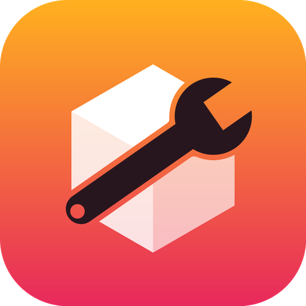
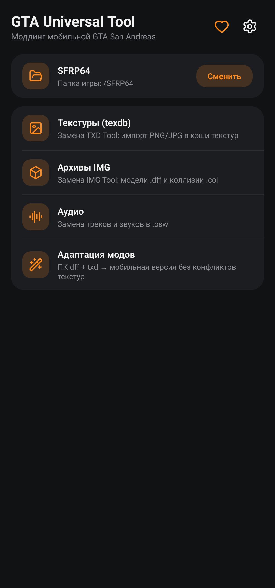
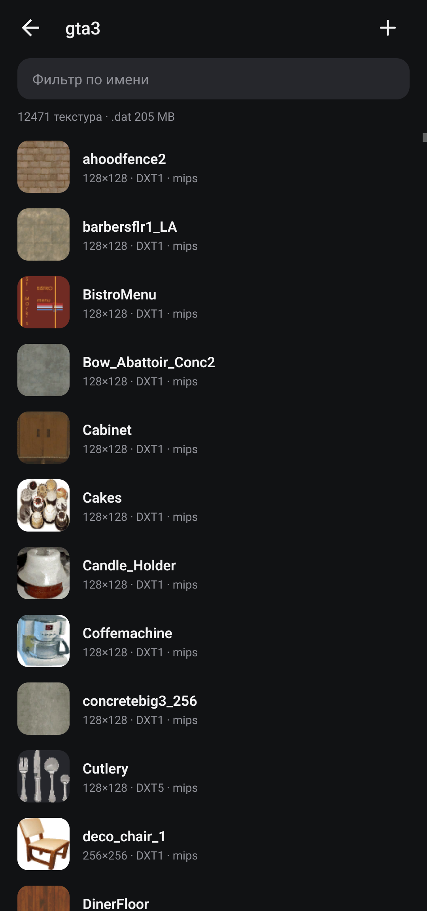

# GTA Universal Tool

**Alat modding lengkap untuk GTA San Andreas mobile di Android**

Cache tekstur (texdb) · arsip IMG · audio · adaptasi mod PC, termasuk retekstur seluruh peta — langsung di ponsel.

[Русский](README.md) · [English](README.en.md) · [Español](README.es.md) · **Bahasa Indonesia**

Pengganti **TXD Tool** dan **IMG Tool** yang gratis dan sumber terbuka untuk GTA San Andreas Android dan klien mobile SA-MP. Tanpa iklan dan pelacak, bekerja offline.

Dibuat dengan dukungan **[San Fierro RolePlay](https://sf-rp.com)**.

> Bermain di server SA:MP? **[SA:MP Monitoring Bot](https://t.me/samp_monitoring_bot)** mengirim notifikasi Telegram tentang peristiwa di server.

## Instalasi

1. Unduh APK dari [Releases](https://github.com/timmylich/gta-universal-tool/releases/latest) lalu pasang.
2. Buka aplikasi dan izinkan "Akses ke semua file" (Android 11+).
3. Pilih folder game, lalu ikuti petunjuk di bawah. Petunjuk yang sama ada di aplikasi: layar utama → "Petunjuk".

## Petunjuk

### Mulai

1. Izinkan "Akses ke semua file": tanpa itu aplikasi tidak bisa melihat file game.

2. Pilih folder game: folder yang berisi texdb/, audio/, data/. Biasanya /SFRP64, /Brentwood dan sejenisnya, atau Android/data/<paket game>/files. Aplikasi mencari folder seperti itu sendiri.

3. Cadangan aktif secara bawaan: sebelum perubahan pertama setiap file disalin ke /GTAUniversalTool/backup.

4. Tutup game sebelum mengubah file dan jalankan lagi sesudahnya.

### Tekstur (texdb)

Cache tekstur berisi apa yang di PC disimpan dalam file .txd. gta3 — peta dan objek, gta_int — interior, txd — kendaraan dan lainnya, samp — objek SA:MP, mobile dan menu — antarmuka.
- Satu tekstur: buka database, cari teksturnya, ketuk → "Ganti dengan gambar".
- Banyak sekaligus: "+" di kepala database, pilih file PNG/JPG. Nama file tanpa ekstensi adalah nama tekstur (huruf besar/kecil tidak berpengaruh). Nama baru ditambahkan, yang sudah ada diganti.
- Tekan lama untuk memilih beberapa tekstur lalu ekspor atau hapus.
- "alias" adalah tautan ke tekstur lain tanpa data sendiri. Jika alias diganti, ia menjadi tekstur terpisah; aslinya tetap.
- Setelah banyak penggantian ketuk "Bangun ulang .dat" untuk mengosongkan ruang data lama.

### Opsi impor

Format "Otomatis" hampir selalu cocok: DXT1 tanpa transparansi, DXT5 dengan transparansi. Biarkan mipmap dan RLE aktif.

"Ukuran maks. → Seperti yang diganti" tidak pernah membuat tekstur lebih besar dari aslinya: game tidak menjadi lebih berat dan tidak keluar karena kekurangan memori.

alphamode: 0 — buram, 1 — potongan (daun, pagar), 2 — tembus cahaya (kaca).

### Arsip IMG

IMG adalah arsip model (.dff), tabrakan (.col) dan animasi. texdb/gta3.img berisi model peta dan kendaraan.
- "+" menambah atau mengganti file: Car.DFF mengganti car.dff.
- Ketuk file untuk mengekspor, mengganti dengan file apa pun, atau menghapusnya.
- Tambahkan model baru hanya jika game akan memuatnya (harus dijelaskan oleh .ide): file berlebih bisa membuat game keluar.
- "Bangun ulang" menghapus celah sisa penggantian dan memperkecil arsip.

### Audio

Paket .osw di folder audio adalah kumpulan mp3. Game memutar trek berdasarkan nomor, jadi urutannya tetap. ▶ memutar, "Ganti mp3" memilih file Anda, "+" menambah trek di akhir. "Terapkan" menulis semua perubahan dalam satu kali bangun ulang.

### Model dari PC

Adaptasi → "Model + tekstur". Tambahkan file .dff (file .txd bernama sama diambil otomatis) dan .txd lain bila perlu. Setiap tekstur mendapat nama unik "prefiks_acak", file .dff ditulis ulang, tekstur bisa langsung masuk ke gta3 dan model ke arsip IMG. Untuk mengganti model di game, nama .dff harus sama dengan yang diganti (mis. infernus.dff). Salinan hasil disimpan di /GTAUniversalTool/adapted.

### Retekstur, termasuk seluruh peta

Adaptasi → "Retekstur". Hanya tekstur yang berubah; model tetap.
- Ekstrak file .txd dari mod PC (mis. dari gta3.img mod musim dingin) ke folder di ponsel dan ketuk "Tambah folder": semua .txd diambil, termasuk subfolder.
- Di PC, file .txd yang berbeda bisa punya tekstur bernama sama tetapi gambarnya berbeda. Cache mobile menyimpannya sebagai "nama_txd" (des_dirt1_cs_mountain), dan yang identik sebagai tautan (alias) ke satu salinan. Aplikasi menaruh setiap tekstur di tempat game mencarinya untuk TXD tersebut: gambar yang sama ditulis sekali, yang berbeda sebagai salinan terpisah.
- "Lewati yang tidak berubah" tidak menyentuh tekstur yang di mod sama dengan di game: lebih cepat dan cache tidak membengkak.
- "Ukuran maks. → Seperti yang diganti" menjaga peta agar tidak lebih berat.
- Sisakan ruang kosong 1–2 GB. Setelah retekstur ketuk "Bangun ulang .dat" di database gta3.

### Jika ada masalah

Game keluar atau tekstur hitam — pulihkan file dari /GTAUniversalTool/backup; di dalamnya jalur dari akar memori diulang (mis. backup/SFRP64/texdb/gta3/…). Penyebab umum: tekstur terlalu besar, model berlebih di IMG, file .dff rusak. Kirim bug dan ide lewat "Dukung proyek → Laporkan bug".

## File yang didukung

| Apa | Di mana | Catatan |
|---|---|---|
| Cache tekstur | `texdb/<db>/<db>.{txt,dxt.toc,dxt.dat,dxt.tmb}` | DXT1, DXT5, RGBA8888, RGB565, RGBA4444, RLE, alias |
| Arsip | `*.img` (VER2) | dff, col, ipl, ifp, … |
| Audio | `audio/*/*.osw` + `.osw.idx` | ZIP tanpa kompresi berisi mp3 |
| Mod PC | `.dff` + `.txd` (D3D8/D3D9) | DXT1/3/5, 8888, 888, 565, 1555, 4444, PAL8 |

Format dijelaskan di [docs/FORMATS.md](docs/FORMATS.md) (bahasa Inggris).

## Dukung proyek

Aplikasi ini dikembangkan di waktu luang. Jika membantu: beri ⭐ pada repositori, ikuti [kanal Telegram](https://t.me/timmylich_portfolio), laporkan bug, atau berdonasi (di aplikasi: ♥ → "Dukung proyek").

## Pengembangan

Aplikasi Android native: Kotlin + Jetpack Compose. Build dan pengujian: [CONTRIBUTING.md](CONTRIBUTING.md) (bahasa Inggris).

## Lisensi

[GNU AGPL v3.0 atau lebih baru](LICENSE). GTA dan Grand Theft Auto adalah merek dagang Take-Two Interactive; proyek ini tidak berafiliasi dengannya. Jangan menyebarkan file game.
