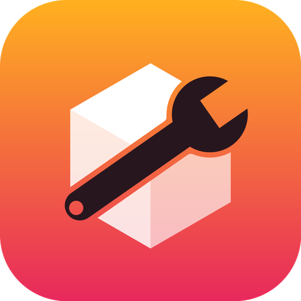
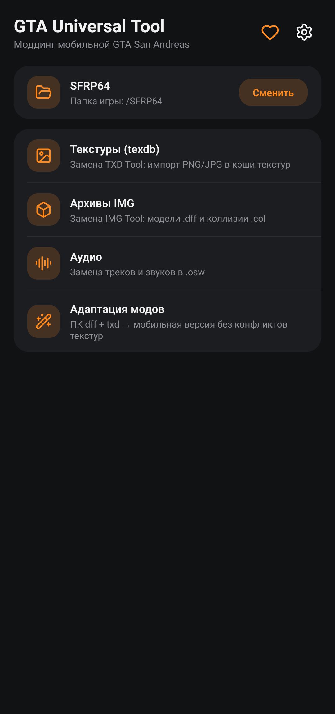
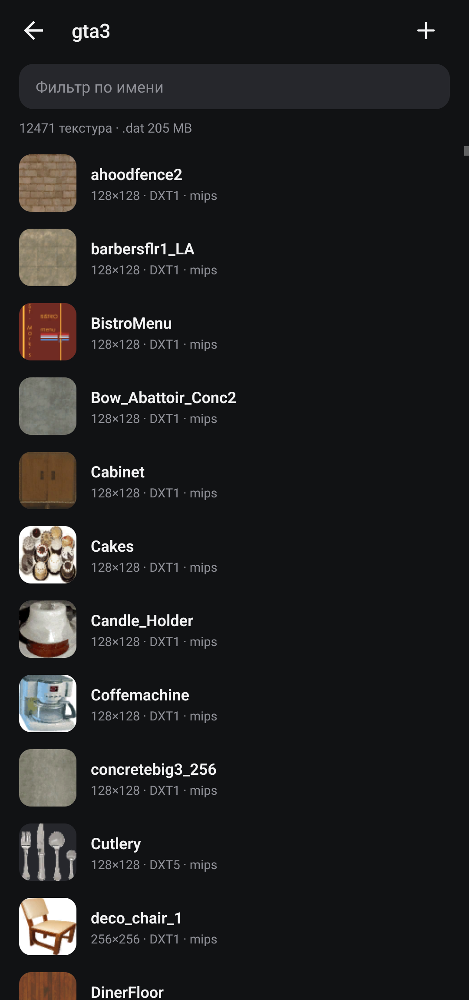

<div align="center">



# GTA Universal Tool

**All-in-one modding tool for mobile GTA San Andreas on Android**

Texture databases (texdb) · IMG archives · audio packs · PC mod adaptation — right on the phone.

[](https://github.com/timmylich/gta-universal-tool/actions/workflows/ci.yml)
[](https://github.com/timmylich/gta-universal-tool/releases/latest)
[](LICENSE)
[](https://t.me/timmylich_portfolio)

[Русский](#русский) · [English](#english)




</div>

## English

A free, open-source replacement for **TXD Tool** and **IMG Tool** for the Android version of GTA San Andreas
and SA-MP mobile clients. No ads, no trackers, works offline.

### Features

- **Textures (texdb)** — browse the texture caches (`texdb/gta3`, `gta_int`, `samp`, …) with previews and search.
  Import PNG/JPG (add or replace; names are case-insensitive), pick the format (auto / DXT1 / DXT5 / RGBA8888 /
  RGB565 / RGBA4444), mipmaps, RLE packing, size limit, power-of-two, `alphamode`, `camnorm`, `streammode` and
  extra attributes. Edit attributes, export PNG, delete, rebuild `.dat` to drop data of replaced textures.
- **IMG archives** — add/replace `.dff`, `.col` and other files (`Car.DFF` replaces the existing `car.dff`),
  warning before adding new entries, replace an entry with any file, export, delete, **rebuild** (removes the gaps
  left by replacements and shrinks the archive).
- **Audio** — `.osw` packs: listen, export, replace mp3 tracks, append tracks; the pack and its `.idx` are rebuilt.
- **Mod adaptation** — PC `dff + txd` → mobile. Several models and dictionaries at once (one TXD may serve many
  models); every used texture gets a unique `prefix_random` name, models are rewritten (incl. MatFX environment
  and specular maps), unused textures are dropped, identical images are stored once. Optionally imports the
  textures into a texdb and the models into an IMG in one step.
- **Retexture** — only `.txd`: every texture replaces the texture with the same name in every database that has it.
- **Backups** — before the first change each game file is copied to `/sdcard/GTAUniversalTool/backup/`.

### Install

- [GitHub Releases](https://github.com/timmylich/gta-universal-tool/releases/latest) (APK)
- F-Droid — submission in progress

The app needs the **All files access** permission (Android 11+) to edit game files in shared storage.

### Supported files

| What | Where | Notes |
|---|---|---|
| Texture databases | `texdb/<db>/<db>.{txt,dxt.toc,dxt.dat,dxt.tmb}` | DXT1, DXT5, RGBA8888, RGB565, RGBA4444, RLE |
| Archives | `*.img` (VER2) | dff, col, ipl, ifp, … |
| Audio | `audio/*/*.osw` + `.osw.idx` | stored ZIP of mp3 |
| PC mods | `.dff` + `.txd` (D3D8/D3D9) | DXT1/3/5, 8888, 888, 565, 1555, 4444, PAL8 |

The formats are documented in [docs/FORMATS.md](docs/FORMATS.md).

## Русский

Бесплатная замена **TXD Tool** и **IMG Tool** с открытым кодом для мобильной GTA San Andreas и SA-MP клиентов
на Android. Без рекламы и трекеров, работает офлайн.

- **Текстуры (texdb)** — просмотр кэшей текстур с превью и поиском; импорт PNG/JPG с выбором формата, мип-карт,
  RLE, размера, `alphamode`, `camnorm`, `streammode`; редактирование атрибутов, экспорт, удаление, пересборка `.dat`.
- **IMG** — добавление/замена `.dff`, `.col` и других файлов (`Car.DFF` заменит `car.dff`), предупреждение перед
  добавлением новых, экспорт, удаление, **пересборка** (уменьшает архив после множества замен).
- **Аудио** — прослушивание, экспорт, замена и добавление mp3 в паках `.osw`.
- **Адаптация модов** — ПК `dff + txd` → мобильная версия: сразу несколько моделей и `.txd` (один `.txd` может
  обслуживать много моделей), уникальные имена текстур `префикс_случайное`, правка `.dff`, удаление лишних
  текстур, сразу импорт в texdb и IMG.
- **Ретекстур** — только `.txd`: текстуры заменяются по своим именам во всех базах, где они есть.
- **Резервные копии** — перед первым изменением каждый файл копируется в `/sdcard/GTAUniversalTool/backup/`.

## Support the project

The app is developed in spare time. Ways to help: ⭐ star the repo, subscribe to the
[Telegram channel](https://t.me/timmylich_portfolio), report bugs, or donate (in the app: Settings → Support).

## Development

Requirements: Node.js 22+, JDK 21, Android SDK (API 36). The UI is React Native + Expo; every binary format is
handled in a native Kotlin module (`modules/gta-native`), whose `core` package has no Android dependencies.

```bash
npm ci
npm run check        # typecheck + lint
npm run test:core    # Kotlin format self-test (synthetic files; plus a real game folder if given)
npm run build:apk    # release APK (Windows script; CI uses the same Gradle steps on Linux)
```

See [CONTRIBUTING.md](CONTRIBUTING.md).

## License

[GNU AGPL v3.0 or later](LICENSE). GTA and Grand Theft Auto are trademarks of Take-Two Interactive; this project
is not affiliated with or endorsed by Rockstar Games or Take-Two Interactive.
